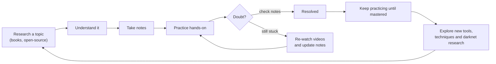

<div align="center">


<a href="https://github.com/Adnan-Kakkattil">
  
</a>

<p>
  <a href="mailto:contact.adnanks@gmail.com"></a>
  <a href="https://www.linkedin.com/in/adnan-kakkattil-3aa559306"></a>
  <a href="https://www.udemy.com/user/adnan-ks-5/"></a>
  <a href="https://medium.com/@adnankakkattil"></a>
</p>

<p>
  
  
  
  
  
  
</p>

</div>

---

## `$ whoami`

<table>
<tr>
<td width="34%" valign="top" align="center">
  
  <br />
  <b>Adnan Kakkattil</b><br />
  <sub>AI Security Engineer &middot; EY &middot; Kerala, India &#x1F1EE;&#x1F1F3;</sub>
</td>
<td width="66%" valign="top">

### I didn't start with a lab. I started with curiosity.

My journey into cybersecurity began in the **sixth standard** &mdash; no sophisticated computers, no expensive equipment, no lab. Just a **mobile phone**, later a tablet, **Linux tools and Termux**.

As part of the **COVID batch** (10th to +2), I turned lockdown into my lab &mdash; installed **Kali Linux** and practiced hacking hands-on. In college I started **teaching cybersecurity** to students and faculty.

**At 18 I was already working in security.** By graduation I had **3 years of industry experience**. Today, at 22, I'm an **AI Security Engineer at EY**, where cybersecurity meets AI.

> *&ldquo;Understanding how a system is designed helps me see how it might fail; understanding how it fails helps me build better systems.&rdquo;*

</td>
</tr>
</table>

<p align="center">
  
</p>

<details>
<summary><b>&#x1F4D6; Read the full story</b></summary>
<br />

**The corona batch.** From 10th standard to +2, I was part of the COVID batch. While the world paused, I invested that time in building myself &mdash; installing Kali Linux, learning hacking techniques and new technologies, and practicing until theory became practical skill.

**Teaching while learning.** When I joined my BSc Computer Science degree, I started taking cybersecurity sessions for students and faculty, ran practical workshops for juniors through seniors, attended events, and led cyber-awareness sessions based on real cyberbullying cases I had worked on.

**Taking the risk.** At 18, alongside my degree, I joined **Thothsparkz LLP** as a Junior Security Engineer &mdash; building application solutions and serving as the company's cybersecurity consultant for a year. In my second year, I won the **Red Team Hacker Academy** scholarship exam in Calicut district, earned my penetration testing certification and was placed at **Red Team Cyber Security Labs**. Offers followed, and at 19 I joined **Gritstone Technologies** at Calicut Cyberpark &mdash; choosing real-world experience over an outdated syllabus. I stopped attending college to work full time, and with the support of my HOD and friends, I still completed my degree &mdash; with three years of experience already behind me.

**The pause, then AI.** At 21 I resigned without another offer to rest and reset. At 22 I joined **EY as an AI Security Engineer** &mdash; bringing hacking, development and security consulting into the world of AI security.

**From experimenting to engineering.** Over the years I expanded into vulnerability assessment and penetration testing, web application security, authentication and authorization flaws, SQL injection, information disclosure and infrastructure security &mdash; and later AI application security, including prompt injection. Some investigations involved complex vulnerability chains, where multiple weaknesses combine into much greater impact. My approach: understand the root cause, establish impact within authorized boundaries, and communicate findings responsibly.

**Security is only one side of the story.** I'm also a full-stack and AI engineer who enjoys building things, not just testing them. Building and breaking are complementary skills.

**Sharing what I learn.** Through my Malayalam Udemy course, ZyrOps Academy, technical sessions and community engagement, I try to make practical cybersecurity education more accessible &mdash; with hands-on demos, isolated labs and objective-based learning that builds reasoning, not tool memorization.

**What I'm working toward.** Making emerging technologies more secure, building useful products, and helping more people develop the skills to understand them.

> *The journey began with a phone and a desire to learn. The tools have changed, the systems have grown more complex &mdash; but the curiosity remains.*

</details>

```python
class AdnanKakkattil:
    role         = "AI Security Engineer @ EY"
    location     = "Kerala, India"
    origin       = {"started": "6th standard", "device": "phone -> tablet", "tools": ["termux", "linux"], "lab": None}
    covid_batch  = "10th to +2: installed Kali Linux, turned lockdown into a hacking lab"
    education    = "BSc Computer Science"
    learning     = "100% self-taught: no mentors, no money - open-source videos, books & practice"
    founder      = "Zero Cost Skill Community - learn, earn and grow with skills"
    trained      = "300+ students in cybersecurity & development"
    career       = {18: "Thothsparkz LLP - Jr Security Engineer & Security Consultant",
                    "UG Y2": "Red Team Hacker Academy scholarship -> Red Team Cyber Security Labs",
                    19: "Gritstone Technologies, Calicut Cyberpark",
                    22: "EY - AI Security Engineer (present)"}

    research     = ["SQL Injection", "IDOR", "Broken AuthN/AuthZ", "Information Disclosure",
                    "Vulnerability Chaining", "Infrastructure Security", "Prompt Injection", "LLM Security"]
    engineering  = ["Full-Stack Development", "AI Applications", "Security Automation", "Lab Environments"]
    teaching     = {"Udemy": "Advanced Practical Ethical Hacking (Malayalam) - 100+ students",
                    "ZyrOps Academy": "academy.zyrops.com - LMS on Web, Android & iOS"}
    publications = 4  # national & international AI / cybersecurity conferences
    languages    = ["Malayalam", "English"]

    def motto(self):
        return "I build, research, teach, and secure technology."
```

---

## &#x1F9ED; The Journey

<p align="center">
  
</p>

### &#x1F4BC; Experience

| When | Role | Organization |
| :-- | :-- | :-- |
| **Age 22 &rarr; Present** | AI Security Engineer | **EY** |
| **Age 19 &rarr; 21** | Cybersecurity | **Gritstone Technologies** &middot; Calicut Cyberpark |
| **2nd year UG** | Certified Penetration Tester (scholarship) | **Red Team Hacker Academy** &rarr; placed at **Red Team Cyber Security Labs** |
| **Age 18** &middot; 1 year | Junior Security Engineer &amp; Cybersecurity Consultant | **Thothsparkz LLP** |
| **During UG** | Cybersecurity trainer &amp; awareness speaker | College sessions, workshops, cyberbullying awareness |

<sub>&#x1F393; BSc Computer Science &mdash; completed while working full time, with 3 years of industry experience at graduation.</sub>

---

## &#x1F4DA; Self-Taught. Self-Led.

> **No mentors. No money. Just time, reach and the right sources.** Everything I know, I learned from open-source videos, free platforms, cybersecurity books and documentation &mdash; purely self-led.



---

## &#x1F9E0; Skills

<table>
  <tr>
    <td width="33%" valign="top">
      <h4>&#x1F3AF; Offensive Security</h4>
      Red Teaming &middot; Network Hacking &middot; System Hacking <sub>(Windows, Linux, macOS, Android)</sub> &middot; IoT Hacking &middot; Reverse Engineering &middot; Social Engineering
    </td>
    <td width="33%" valign="top">
      <h4>&#x1F575;&#xFE0F; Intelligence &amp; Darknet</h4>
      OSINT &middot; Data Leak &amp; Breach Hunting &middot; Darknet Research &middot; Privacy &amp; Anonymity
    </td>
    <td width="33%" valign="top">
      <h4>&#x1F510; Physical &amp; Hardware</h4>
      Physical Pentesting &middot; Lock Picking &middot; Hardware Hacking
    </td>
  </tr>
  <tr>
    <td width="33%" valign="top">
      <h4>&#x1F916; AI &amp; Defence</h4>
      AI Security &middot; AI Engineering &middot; Blue Teaming
    </td>
    <td width="33%" valign="top">
      <h4>&#x1F4BB; Full-Stack Development</h4>
      Python &middot; Rust &middot; PHP &middot; Node.js &middot; Go
    </td>
    <td width="33%" valign="top">
      <h4>&#x1F3A4; Beyond the Keyboard</h4>
      Public Speaking &middot; Research &amp; Development &middot; Training &amp; Mentoring
    </td>
  </tr>
</table>

---

## &#x26A1; Four Verbs. One Practice.

<table>
  <tr>
    <td width="25%" valign="top">
      <h3>&#x1F6E0;&#xFE0F; Build</h3>
      Full-stack &amp; AI applications, workflow automation and tools that solve practical engineering problems.
      <br /><br />
      <code>full-stack</code> <code>llm-apps</code> <code>automation</code>
    </td>
    <td width="25%" valign="top">
      <h3>&#x1F52C; Research</h3>
      Vulnerability research across web, infrastructure and AI systems &mdash; root cause first, disclosed responsibly.
      <br /><br />
      <code>vapt</code> <code>vuln-chains</code> <code>llm-sec</code>
    </td>
    <td width="25%" valign="top">
      <h3>&#x1F393; Teach</h3>
      Hands-on, lab-driven cybersecurity education in Malayalam &amp; English &mdash; reasoning over memorizing tools.
      <br /><br />
      <code>udemy</code> <code>zyrops</code> <code>talks</code>
    </td>
    <td width="25%" valign="top">
      <h3>&#x1F6E1;&#xFE0F; Secure</h3>
      AI security at EY &mdash; threat modelling the new risks that appear as AI enters enterprise software.
      <br /><br />
      <code>prompt-injection</code> <code>ai-red-team</code>
    </td>
  </tr>
</table>

---

## &#x1F510; Vulnerability Research Portfolio

> Case studies, not claims. Research conducted within authorized boundaries and disclosed responsibly &mdash; organizations, credentials, exploit chains and internal details are **not** published without permission.

<table>
  <tr>
    <td width="50%" valign="top">
      <h4>&#x1F3DB;&#xFE0F; 01 &middot; Government &amp; Education Systems</h4>
      <br /><br />
      Research into state-level education and university management platforms handling large volumes of student and institutional data.
    </td>
    <td width="50%" valign="top">
      <h4>&#x1F489; 02 &middot; SQL Injection &rarr; Server-Side Impact</h4>
      <br /><br />
      Investigation of a biometric / attendance management server that progressed from SQL injection to remote code execution and broader server impact.
    </td>
  </tr>
  <tr>
    <td width="50%" valign="top">
      <h4>&#x1F916; 03 &middot; AI &amp; LLM Security</h4>
      <br /><br />
      Prompt injection research in private programs, and a household-restriction bypass on a major consumer streaming platform.
    </td>
    <td width="50%" valign="top">
      <h4>&#x1F4F9; 04 &middot; Infrastructure &amp; Surveillance</h4>
      <br /><br />
      An assessment that identified exposure of 300+ surveillance cameras at a multinational manufacturing facility, with corrective actions recommended.
    </td>
  </tr>
</table>

<details>
<summary><b>&#x1F9EA; How I approach research</b></summary>
<br />

1. **Understand the system** &mdash; architecture, trust boundaries, data flows.
2. **Find the root cause** &mdash; not just the symptom or payload.
3. **Establish impact** &mdash; strictly within authorized testing boundaries.
4. **Chain carefully** &mdash; small weaknesses can combine into critical impact.
5. **Disclose responsibly** &mdash; clear reporting, remediation guidance, no public exposure of sensitive details.

</details>

---

## &#x1F393; Teaching &amp; ZyrOps Academy

<table>
  <tr>
    <td width="55%" valign="top">
      <h3>&#x1F525; Advanced Practical Ethical Hacking &mdash; <i>Malayalam</i></h3>
      A continuously evolving, 100% hands-on Udemy course for Malayalam-speaking learners.
      <ul>
        <li>&#x2705; Practical cybersecurity concepts &amp; real-world demos</li>
        <li>&#x2705; Hands-on labs and exercises</li>
        <li>&#x2705; Ethical hacking methodology &amp; industry best practices</li>
        <li>&#x2705; Beginner-friendly, with new modules added regularly</li>
      </ul>
      
      
      
      <br /><br />
      <b>Enroll on:</b><br />
      <a href="https://www.udemy.com/user/adnan-ks-5/"></a>
      <a href="https://academy.zyrops.com"></a>
    </td>
    <td width="45%" valign="top">
      <h3>&#x1F9E0; How I teach</h3>
      <ol>
        <li>Hands-on demonstrations over slides</li>
        <li>Isolated labs you can break safely</li>
        <li>Real-world scenarios &amp; objectives</li>
        <li>Reasoning, not memorizing tools</li>
      </ol>
      <h3>&#x1F3EB; ZyrOps Academy</h3>
      A dedicated cybersecurity academy with its own <b>LMS on Web, Android &amp; iOS</b> &mdash; mentor-led cohorts, real attack labs, portfolio projects and placement support across ethical hacking, SOC, web app testing, cloud and AI security. Trusted by 500+ learners.
      <br /><br />
      
      
      
      <br /><br />
      <a href="https://academy.zyrops.com">academy.zyrops.com &rarr;</a>
    </td>
  </tr>
  <tr>
    <td colspan="2" align="center">
      <h3>&#x1F331; Founder &mdash; Zero Cost Skill Community</h3>
      I learned everything for free, so I built a community where anyone can <b>learn, earn and grow</b> with skills &mdash; without money being the barrier.
      <br /><br />
      
      
      
    </td>
  </tr>
</table>

---

## &#x1F4DA; Publications &middot; &#x1F3A4; Speaking &middot; &#x1F91D; Community

<table>
  <tr>
    <td width="50%" valign="top">
      <h4>&#x1F4C4; Conference Publications</h4>
      <ul>
        <li><i>Paper title &mdash; AI security</i> &middot; International Conference &middot; <a href="#">DOI</a></li>
        <li><i>Paper title &mdash; Cybersecurity</i> &middot; International Conference &middot; <a href="#">DOI</a></li>
        <li><i>Paper title &mdash; AI / ML systems</i> &middot; National Conference &middot; <a href="#">DOI</a></li>
        <li><i>Paper title &mdash; Security research</i> &middot; National Conference &middot; <a href="#">DOI</a></li>
      </ul>
    </td>
    <td width="50%" valign="top">
      <h4>&#x1F310; Events &amp; Sessions</h4>
      <ul>
        <li><b>c0c0n 2026</b>, Kochi &mdash; attended; explored AI-driven cyber threat intelligence</li>
        <li><b>Kerala Cyber Suraksha Summit 2026</b>, Le M&eacute;ridien Kochi &mdash; attended</li>
        <li>College &amp; community technical sessions on ethical hacking and AI security</li>
        <li>Corporate &amp; academic training via ZyrOps Academy</li>
      </ul>
    </td>
  </tr>
</table>

---

## &#x1F9F0; Arsenal

<p align="center"><b>Offensive Security</b></p>
<p align="center">
  
  
  
  
  
  
  
  
  
  
</p>

<p align="center"><b>AI &amp; LLM Security</b></p>
<p align="center">
  
  
  
  
  
</p>

<p align="center"><b>Engineering</b></p>
<p align="center">
  <a href="https://skillicons.dev">
    
  </a>
</p>

---

## &#x1F4CA; GitHub Analytics

<div align="center">


</div>

---

## &#x1F40D; Hunting Bugs Through My Contributions

<picture>
  <source media="(prefers-color-scheme: dark)" srcset="https://raw.githubusercontent.com/Adnan-Kakkattil/Adnan-Kakkattil/output/github-snake-dark.svg" />
  <source media="(prefers-color-scheme: light)" srcset="https://raw.githubusercontent.com/Adnan-Kakkattil/Adnan-Kakkattil/output/github-snake.svg" />
  
</picture>

---

## &#x1F4E1; Find My Content

<div align="center">

| &#x1F4BC; LinkedIn | &#x1F393; Udemy | &#x270D;&#xFE0F; Medium | &#x1F3EB; ZyrOps Academy |
| :---: | :---: | :---: | :---: |
| [Articles &amp; updates](https://www.linkedin.com/in/adnan-kakkattil-3aa559306) | [Ethical Hacking &mdash; Malayalam](https://www.udemy.com/user/adnan-ks-5/) | [Technical write-ups](https://medium.com/@adnankakkattil) | [academy.zyrops.com](https://academy.zyrops.com) |

</div>

---

## &#x1F3AF; What I'm Working Toward

- &#x1F6E1;&#xFE0F; Making **AI systems and emerging technologies more secure**
- &#x1F52C; Deeper **vulnerability research** and **secure software engineering**
- &#x1F6E0;&#xFE0F; Building **useful AI products** with security from day one
- &#x1F393; Helping more people &mdash; especially Malayalam-speaking learners &mdash; **understand the systems they test**

---

<div align="center">

### &#x1F91D; Let's Connect

Open to **AI security research, collaborations, conference talks, college sessions and corporate training**.

<p>
<a href="mailto:contact.adnanks@gmail.com"></a>
<a href="https://www.linkedin.com/in/adnan-kakkattil-3aa559306"></a>
<a href="https://www.udemy.com/user/adnan-ks-5/"></a>
<a href="https://medium.com/@adnankakkattil"></a>
<a href="https://www.instagram.com/adnan.kakkattil/"></a>
<a href="https://www.facebook.com/adnan.kakkattil0/"></a>
<a href="https://github.com/Adnan-Kakkattil"></a>
</p>

<br />

<sub><i>&ldquo;The journey began with a phone and a desire to learn. The tools have changed &mdash; but the curiosity remains.&rdquo;</i></sub><br />
<sub><b>I am Adnan Kakkattil. I build, research, teach, and secure technology.</b></sub>


</div>
